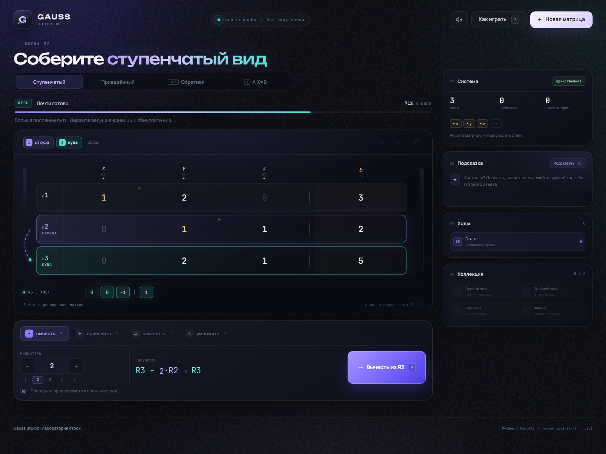
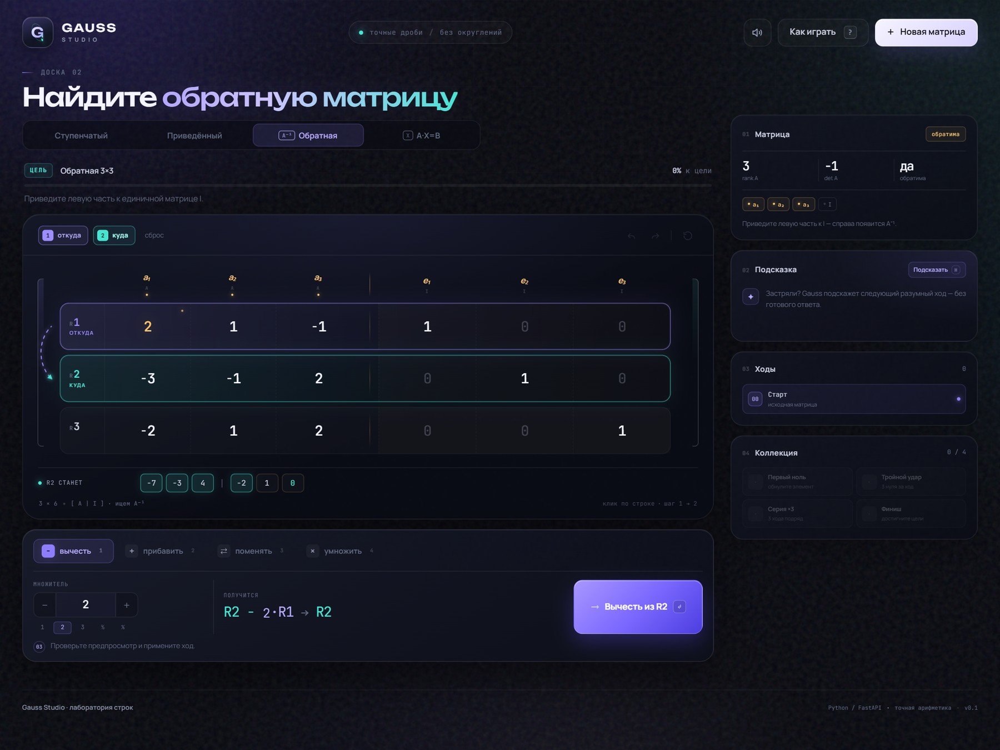
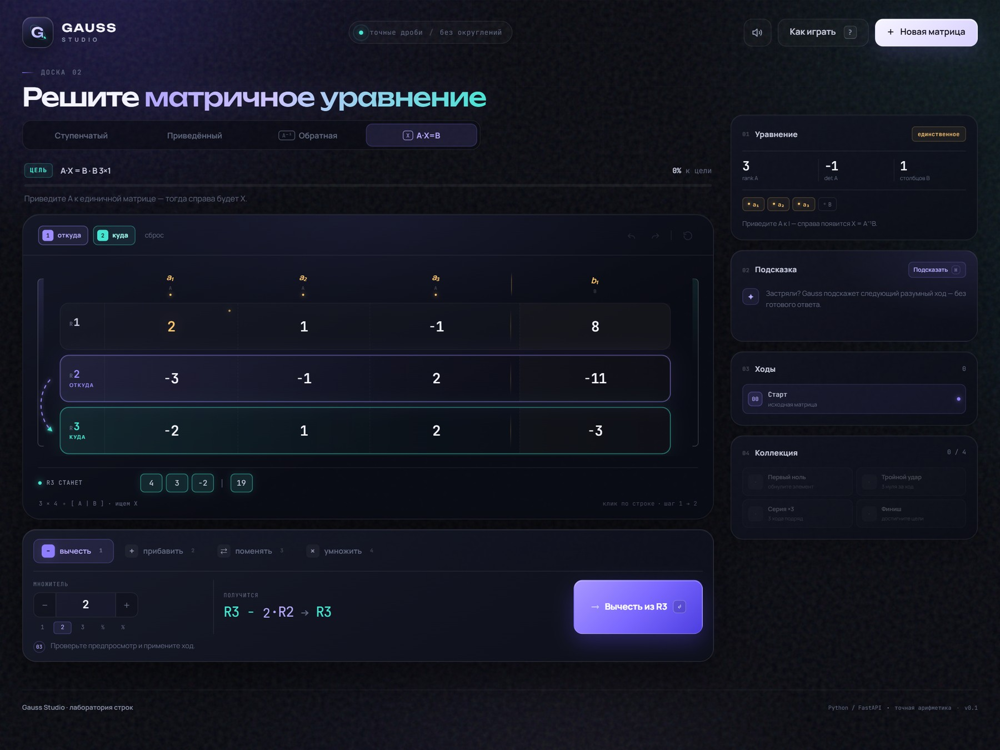
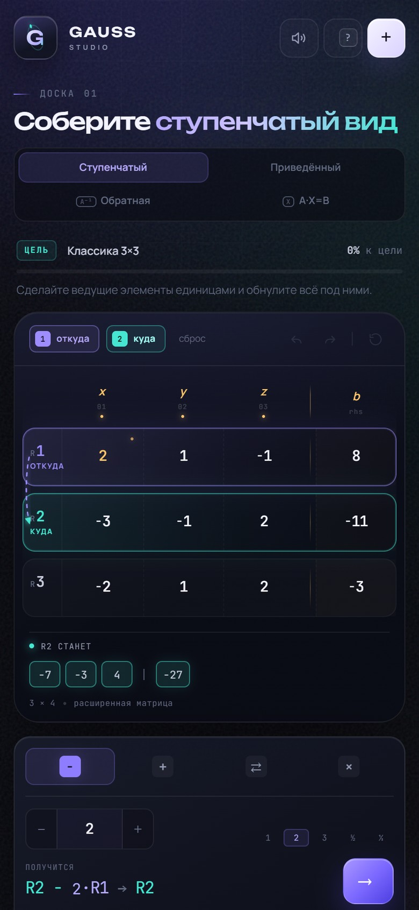

# Gauss Studio

> **Лаборатория строк.** Красивая интерактивная среда для элементарных преобразований расширенных матриц, поиска обратной матрицы и решения матричных уравнений.

<p align="center">
  
</p>

<p align="center">
  
  
  
  
  
</p>

Gauss Studio — это не калькулятор, который молча выдаёт ответ, а **тактильный тренажёр метода Гаусса**. Вы выбираете строку-источник, строку-цель, множитель — и видите, как матрица меняется ход за ходом. Все вычисления идут в точных рациональных дробях на Python, поэтому `1/3` остаётся `1/3`, а нули — настоящими нулями.

---

## Что умеет

- **Выбор «откуда → куда».** Клик по строке-источнику, клик по строке-цели — интерфейс сам собирает выражение `R3 − 2·R2`.
- **Живой предпросмотр.** Ещё до применения видно, какой станет строка-цель и где появятся нули.
- **Точные дроби.** `fractions.Fraction` на сервере, `BigInt`-дроби для мгновенного предпросмотра в браузере. Никаких округлений.
- **Четыре операции.** Вычесть, прибавить, поменять строки местами, умножить строку на число.
- **Четыре режима.** Ступенчатый вид, приведённый ступенчатый вид (Гаусс — Жордан), **поиск A⁻¹** и **матричное уравнение A·X = B**.
- **Режим обратной матрицы.** A автоматически дополняется единичной `[A | I]`; приведите левую часть к `I` — справа появится `A⁻¹`. Вырожденные матрицы и `det A = 0` распознаются сразу.
- **Матричные уравнения.** `A·X = B` с несколькими столбцами `B`: после приведения A к `I` справа появляется `X = A⁻¹B`. Совместные, несовместные и недоопределённые случаи различаются.
- **Умные подсказки.** Сервер предлагает следующий осмысленный ход с объяснением, но не показывает готовый ответ.
- **История с ветвлением.** Любой ход можно отменить, повторить или прыгнуть к нему; новые действия обрезают «будущее».
- **Анализ системы.** Ранг, детерминант, число свободных переменных, совместность, противоречие, а после достижения цели — готовое решение или `A⁻¹`.
- **Азарт.** Серии результативных ходов, коллекция достижений, конфетти, синтезированный звук и праздничный финал.
- **Свои матрицы.** Системы до `8 × 10`, обратная матрица до `8 × 8`, уравнения с `A` до `8 × 8` и несколькими столбцами `B`, дробные значения, отключаемая правая часть, случайная матрица и готовые вызовы.
- **Адаптивность.** Полноценная работа на телефоне, поддержка клавиатуры и `prefers-reduced-motion`.
- **Автосохранение.** Доска, режим, история и найденный детерминант переживают перезагрузку страницы.

---

## Быстрый старт

Нужен [uv](https://docs.astral.sh/uv/) и Python 3.11+ (uv подберёт подходящий интерпретатор).

```bash
cd AIG/gauss
uv sync --all-groups
uv run gauss-studio
```

Откройте **http://127.0.0.1:8765**.

Другие варианты запуска:

```bash
# другой порт
uv run gauss-studio --port 9000

# доступ с других устройств в локальной сети
uv run gauss-studio --host 0.0.0.0 --port 8765

# режим разработки с автоперезагрузкой
uv run gauss-studio --reload
```

Документация API (Swagger UI) — на **http://127.0.0.1:8765/api/docs**.

---

## Как играть

1. **Выберите «откуда».** Кликните по строке, из которой будете вычитать. Она подсветится фиолетовым.
2. **Выберите «куда».** Кликните по строке-цели. Она подсветится бирюзовым, а внизу появится предпросмотр.
3. **Задайте множитель** (`2`, `1/2`, `−3/4`, `0.5`) и нажмите **«Вычесть»**.

Цель — собрать «лесенку»: ведущие единицы, нули под ними (для приведённого вида — ещё и над ними). Когда получится, Gauss устроит праздник.

### Обратная матрица

Нажмите вкладку **«A⁻¹ Обратная»**:

1. Если текущая матрица коэффициентов квадратная, Gauss сразу построит `[A | I]`.
2. Если нет — откроется конструктор квадратной `A` (до `8 × 8`).
3. Выполняйте обычные преобразования строк. Цель — единичная матрица слева.
4. Когда слева появится `I`, справа будет `A⁻¹`; результат также покажется в панели «Матрица» и в финальном окне.

По пути панель показывает `rank A`, `det A` и признак обратимости. Если `det A = 0`, Gauss сразу предупредит, что обратной матрицы не существует, и не будет предлагать ложных подсказок.

### Матричное уравнение A·X = B

Нажмите вкладку **«X A·X=B»**:

1. Введите квадратную `A` и матрицу `B` — одну или несколько столбцов.
2. Gauss строит доску `[A | B]`.
3. Приведите `A` к `I`; правая часть превратится в `X = A⁻¹B`.
4. Для необратимой `A` режим честно различает два случая: **решений нет**, если `rank[A|B] > rank A`, и **бесконечно много решений**, если ранги равны.

Результат `X` показывается и в боковой панели, и в финальном окне. Все дроби точные.

### Горячие клавиши

| Клавиша | Действие |
|---|---|
| `1` — `4` | вычесть / прибавить / поменять / умножить |
| `H` | подсказка |
| `Enter` | применить операцию |
| `Esc` | сбросить выбор |
| `Ctrl+Z` / `Ctrl+Shift+Z` | отменить / повторить |
| `?` | помощь |

---

## Скриншоты

### Режим обратной матрицы



### Матричное уравнение



### Финал и мобильная версия

| Праздничный финал | Мобильная версия |
|---|---|
|  |  |

---

## Как это устроено

```
┌──────────────────────────────┐        JSON         ┌─────────────────────────────┐
│  Браузер                     │  ───────────────▶   │  Python / FastAPI           │
│  • отрисовка матрицы         │                     │  • fractions.Fraction       │
│  • анимации и звук           │  ◀───────────────   │  • проверка операций        │
│  • мгновенный предпросмотр   │   точный результат  │  • план и подсказки         │
│  • история и undo/redo       │                     │  • анализ совместности      │
└──────────────────────────────┘                     └─────────────────────────────┘
```

Браузер никогда не «додумывает» математику: перед применением он делает только предпросмотр, а канонический результат, ранг и следующую подсказку считает Python. Это позволяет держать интерфейс быстрым и при этом гарантировать точность.

### Точная арифметика

- `Fraction` нормализует знак и делит на НОД, так что `2/4` всегда превращается в `1/2`.
- Ноль — это ровно `0`, а не `1e-17`; поэтому условие «обнулилось» проверяется без допусков.
- Предпросмотр в JS использует `BigInt` и ту же логику нормализации.
- Функция подсказки строит реальную последовательность элементарных операций и отдаёт первый шаг; каждый шаг можно применить вручную.

---

## API

Все эндпоинты, кроме `GET /api/health` и `GET /api/presets`, принимают JSON.

| Метод | Путь | Назначение |
|---|---|---|
| `GET` | `/api/health` | статус сервера |
| `GET` | `/api/presets` | готовые доски и названия целей |
| `POST` | `/api/analyze` | ранг, детерминант, совместность, решение, X, цель |
| `POST` | `/api/operation` | применить одну операцию |
| `POST` | `/api/hint` | следующий подсказанный ход |
| `POST` | `/api/solve` | полный разбор до выбранной цели |

Пример запроса операции:

```bash
curl -X POST http://127.0.0.1:8765/api/operation \
  -H "Content-Type: application/json" \
  -d '{
    "matrix": [["2","1","-1","8"],["-3","-1","2","-11"],["-2","1","2","-3"]],
    "augmented": 1,
    "goal": "echelon",
    "op": "subtract",
    "source": 0,
    "target": 1,
    "factor": "3"
  }'
```

Ответ содержит новую матрицу, изменённые клетки, число созданных нулей, выражение хода и обновлённый анализ.

---

## Разработка

```bash
uv sync --all-groups

uv run pytest              # 49 тестов ядра и API
uv run ruff check .        # линтер
uv run ruff format --check .
```

Тесты проверяют, что каждый пресет приводится к обеим целям, что итог действительно ступенчатый (или приведённый), что операции точны, что обратная матрица и решения `A·X = B` находятся с проверкой на вырожденных случаях, а несовместные и недоопределённые системы распознаются корректно.

### Структура проекта

```
AIG/gauss/
├── pyproject.toml               # проект, зависимости, pytest и ruff
├── uv.lock                      # воспроизводимое окружение
├── src/gauss_studio/
│   ├── engine.py                # точная линейная алгебра, планы, подсказки
│   ├── app.py                   # FastAPI, статика, REST API
│   ├── __main__.py              # CLI-запуск gauss-studio
│   └── static/
│       ├── index.html
│       ├── styles.css           # дизайн-система, адаптив, анимации
│       ├── app.js               # состояние, рендеринг, звук, конфетти
│       └── fonts/               # локальные вариативные шрифты
├── tests/
│   ├── test_engine.py
│   └── test_api.py
├── docs/                        # скриншоты для README
└── .github/workflows/ci.yml
```

### Технологии

- **Python 3.11+**, `fractions`, `dataclasses`
- **FastAPI + Uvicorn**, Pydantic-валидация
- **Vanilla JS + CSS**, без сборщика и фреймворков
- **uv** для окружения, **pytest** и **ruff** для качества
- Локальные шрифты Manrope, Unbounded и JetBrains Mono — интерфейс не зависит от CDN

---

## Лицензия

MIT. Подробности — в [LICENSE](LICENSE).
